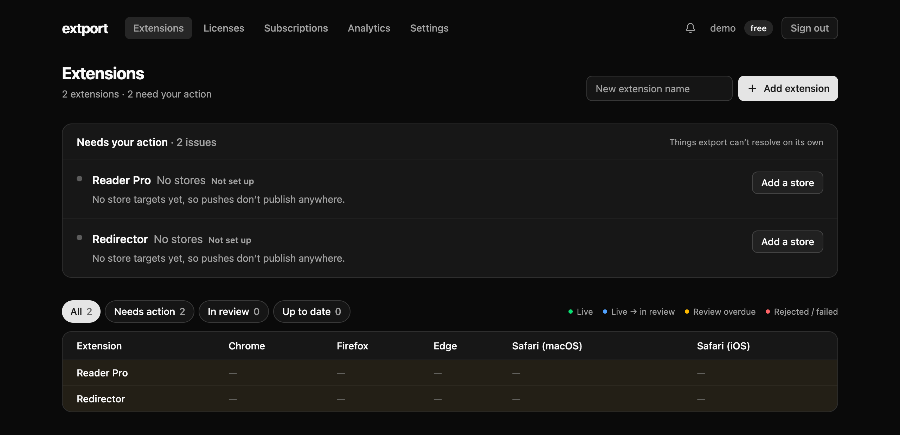

extport is in open beta — sign in with GitHub and your account works immediately, no waitlist. It's free during
the beta, and the free tier is permanent: **3 extensions** (artifacts up to **64 MB** each), analytics included —
the limits are written here so you never discover them by hitting them. Paid plans for bigger fleets come after
the beta; see [the pricing principles](https://extport.dev/#pricing) for what's fixed already.
[Join the Discord](https://discord.gg/Va9kcSqu3f) for questions, feedback, or anything broken — it's the fastest
way to reach us.

## 1. Sign in

Go to [dash.extport.dev](https://dash.extport.dev) and sign in with GitHub.

## 2. Create an extension

Enter a name and click **Add extension**. This is the thing you'll push versions to, sell licenses or subscriptions for, and
see usage analytics on — one extension can have a target configured for each of Firefox, Chrome, Edge, and Safari,
plus its own licensing plans.



The name is just a label — the real identity is the `ext_…` id shown beneath it, which the SDK, CLI, and CI all
reference and which never changes. Pick whatever name makes sense to you and your users.

## 3. Wire up your project with WXT

[WXT](https://wxt.dev) is extport's first-class integration — [`@extport/wxt`](/wxt/) handles `extport.config.json`
syncing, runtime `extensionId` injection, manifest permission checks, analytics wiring, and Safari Xcode generation
from a single config block.

### Starting a new extension

Let the scaffold wire up everything from scratch (run in a parent folder, not inside an existing project):

```sh
npx @extport/cli login
npx @extport/cli init
```

`extport init` creates a WXT project pre-wired with [`@extport/wxt`](/wxt/), bound to a real extension record from
birth — including `permissions: ['storage']` and the GitHub Actions workflow that pushes to every store when you bump
the version. It can also create the extension record for you, so steps 2 and 3 collapse into one.

### Adding to an existing WXT project

Install `@extport/wxt` and add your extension id to `wxt.config.ts`:

```sh
pnpm add -D @extport/wxt
```

```ts
// wxt.config.ts
export default defineConfig({
  modules: ['@extport/wxt'],
  manifest: {
    // Required by @extport/wxt — backs @extport/sdk's browser.storage.local persistence
    permissions: ['storage'],
  },
  extport: {
    extension: 'ext_…', // the id shown under your extension's name in the dashboard
  },
})
```

The next `wxt prepare` (or `pnpm install`) writes `extport.config.json` automatically so the CLI and GitHub Actions
resolve your extension id without hardcoding, and injects `extensionId` into every entrypoint for [`@extport/sdk`](/sdk/).

:::note[Not using WXT?]
Create `extport.config.json` next to your `package.json` with `{ "extension": "ext_…" }`. When using `@extport/sdk`,
pass `extensionId: 'ext_…'` explicitly and include `"storage"` in your `manifest.json` permissions.
:::

## What's next

Each module is independent — adopt any of them, in any order:

- [Publishing](/publishing/) — start with **Firefox** (fastest setup: just an API key pair), then connect Chrome,
  Edge, and Safari and push every store from one command.
- [Licensing](/licensing/) — sell one-time activation codes with zero backend via Stripe Connect, hosted checkout
  links, and `@extport/sdk`.
- [Subscriptions](/subscriptions/) — sell recurring monthly or yearly plans for account-based extensions with
  server-side entitlements and a built-in buyer portal.
- [Analytics](/analytics/) — one anonymous ping per install per day, rolled up into weekly actives, installs, and
  version adoption across all four stores.
