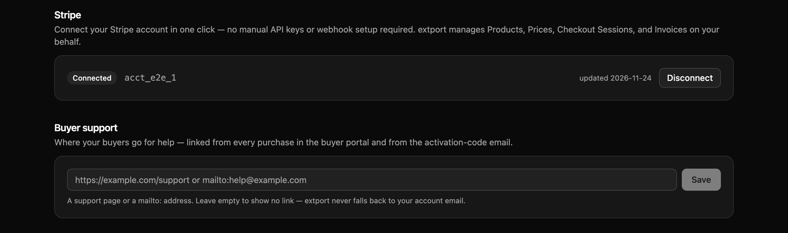
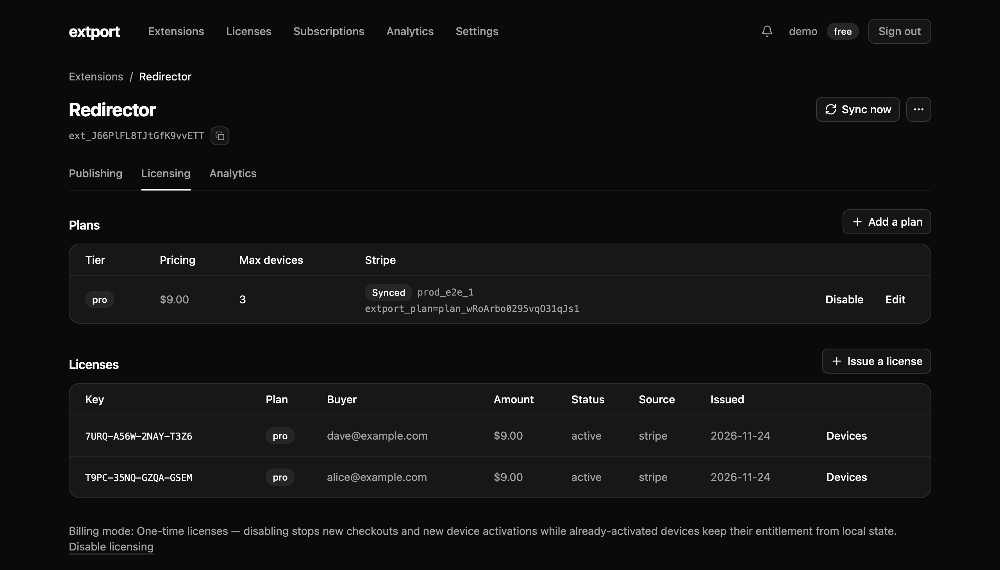

Licensing is built for **standalone browser extensions with no backend**. Connect your Stripe account once via Stripe
Connect, create a one-time plan, link your "Buy Pro" button to extport's hosted checkout URL, and verify activation
codes (`XXXX-XXXX-XXXX-XXXX`) directly from your extension with [`@extport/sdk`](/sdk/).

No manual Restricted Keys, no manual webhooks, and no server to maintain — payments settle straight into your Stripe
account while extport handles fulfillment, emails, device seat limits, and the buyer portal.

:::note[Selling recurring subscriptions with user accounts?]
If your extension has its own backend and user accounts and you want monthly/yearly billing instead of activation codes,
see [Subscriptions](/subscriptions/). Each extension chooses one billing mode (`license` or `subscription`), locked once
you create its first plan, license, or subscription.
:::

## 1. Connect your Stripe account

Go to [**Settings → Stripe**](https://dash.extport.dev/settings#payment-credentials) and click **Connect with Stripe**.

This uses Stripe Connect Standard OAuth2:

- You can connect a Stripe Sandbox / Test account first, then switch to Live mode when ready.
- All Stripe webhooks (`checkout.session.completed`, `charge.refunded`, `charge.dispute.created`) are handled
  automatically by extport's platform Connect webhook — nothing to configure in Stripe Workbench.
- A connected Stripe account is required before you can enable licensing on an extension.



## 2. Enable licensing and create a plan

Open your extension in the dashboard, switch to the **Licensing** tab, choose **One-time License**, and enable
licensing.

Then create your plan(s). Each extension maps to **one Stripe Product**, and each plan row maps **1:1 to a Stripe
Price** synced automatically to your connected Stripe account:

- **Tier** — the entitlement level your extension checks (e.g. `pro`). `free` is reserved for the unpaid tier.
- **Price** — a one-time `amount` (minimum 50 minor units) and `currency` (defaults to USD). Editing the price later
  creates a new Stripe Price and archives the previous one automatically.
- **Max devices** — how many devices a single activation code covers (1–100, default 3; editable later and snapshotted
  onto codes issued from then on).
- **Disable / re-enable** — soft-disable a plan (`active: false`) to stop new checkouts without affecting existing
  buyers.

Activation codes verify against your **extension's id** (`ext_…`), which never changes — renaming the extension is
cosmetic and never breaks verification.



## 3. Wire up your extension with WXT & `@extport/sdk`

Pair [`@extport/wxt`](/wxt/) with [`@extport/sdk`](/sdk/) so `extensionId` injects automatically into every entrypoint:

```sh
pnpm add @extport/sdk
```

```ts
// wxt.config.ts
export default defineConfig({
  modules: ['@extport/wxt'],
  manifest: {
    // Required by @extport/wxt — @extport/sdk stores activation state in browser.storage.local
    permissions: ['storage'],
  },
  extport: {
    extension: 'ext_…',
  },
})
```

Create a shared activation client and attach it in your background entrypoint:

```ts
// lib/activation.ts — shared across popup, options, content scripts, and background
import { createActivationClient } from '@extport/sdk'
import { webextTransport } from '@extport/sdk/webext'

export const client = createActivationClient({
  // extensionId is injected automatically by @extport/wxt
  plans: {
    free: { records: 100 }, // 'free' is required
    pro: { records: Infinity }, // tier names match your plan tiers
  },
  transport: webextTransport(),
})
```

```ts
// entrypoints/background.ts — syncs activations across contexts and re-verifies on startup
import { attachBackground } from '@extport/sdk/webext'
import { client } from '../lib/activation'

export default defineBackground(() => {
  attachBackground(client)
})
```

In your UI, redeem codes and gate features with `client.activate()` / `client.getPlan()` (or `usePlan(client)` from
`@extport/sdk/react`):

```ts
await client.activate('XXXX-XXXX-XXXX-XXXX')
const plan = await client.getPlan() // { tier: 'pro', limit: { records: Infinity } }
```

:::note[Storage & non-WXT projects]
`@extport/sdk` persists activation state in `browser.storage.local` (`extport-plan`) when available, with automatic
lazy migration from legacy `idb-keyval` installs. If you are not using WXT, pass `extensionId: 'ext_…'` to
`createActivationClient` and add `"storage"` to your `manifest.json` permissions.
:::

You can test the full activation loop before running a Stripe payment: click **Issue a license** on the extension's
Licensing tab to mint a test code and redeem it in a dev build.

## 4. Sell with a hosted checkout link

Every active plan gets a ready-to-use public checkout URL with **no API key or backend required**:

```
https://portal.extport.dev/api/v1/portal/buy/<plan_id>
```

Link your website's "Buy Pro" button or your extension's upgrade CTA straight to that URL:

- Creates a fresh Stripe Checkout Session (`mode: 'payment'`, promotion codes enabled) and redirects (`303`) straight
  to Stripe Checkout.
- After payment, buyers land on extport's hosted success page
  (`https://portal.extport.dev/purchase/success?session_id={CHECKOUT_SESSION_ID}`), which shows their activation code
  immediately — and the same code arrives in their inbox.
- Need custom redirects? Append `?success_url=https://…&cancel_url=https://…` to the buy URL.

:::note[Calling from your own backend?]
If you do have a backend, you can create Checkout Sessions via `POST /api/v1/licensing/checkout` (passing `extensionId`,
`tier`, `externalUserId`, `email`, `successUrl`, and `cancelUrl`), check license entitlements server-side with
`GET /api/v1/licensing/entitlements`, or bind a key to a user with `POST /api/v1/licensing/bind`.
:::

## 5. Monitor sales, devices, and the buyer portal

- **Extension → Licensing**: open any license's **Devices** dialog to inspect each activated device's **browser & OS**,
  **region**, **IP address**, and heartbeat timestamps — or click **Release seat** to free a slot immediately.
- **Global [Licenses](https://dash.extport.dev/licenses)**: 30-day revenue and licenses-sold charts plus cross-extension
  search.
- **Self-serve Buyer Portal**: buyers can sign in at [portal.extport.dev/portal](https://portal.extport.dev/portal)
  with their purchase email (passwordless magic link) to copy their activation codes and view active devices
  (browser/OS and region; IP addresses are hidden). Set an optional help link in
  [**Settings → Buyer support**](https://dash.extport.dev/settings#buyer-support).

## How the rest behaves

- **Refunds & disputes revoke automatically.** `charge.refunded` and `charge.dispute.created` flip a license to
  `refunded`; activated devices lose the entitlement on their next online check.
- **Seats decay lazily.** A device idle for 30 days frees its seat automatically the moment another device needs one —
  reinstalls never wedge a license permanently. You can also release a seat immediately from the license's Devices
  dialog.
- **Codes outlive outages.** Verification failures caused by network problems or server hiccups never clear local
  state — only an explicit server rejection revokes an activated device. The failure mode is always "no new
  activations", never "paid features turn off".
