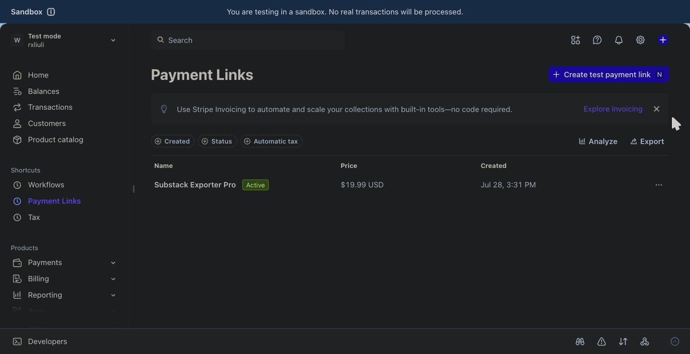
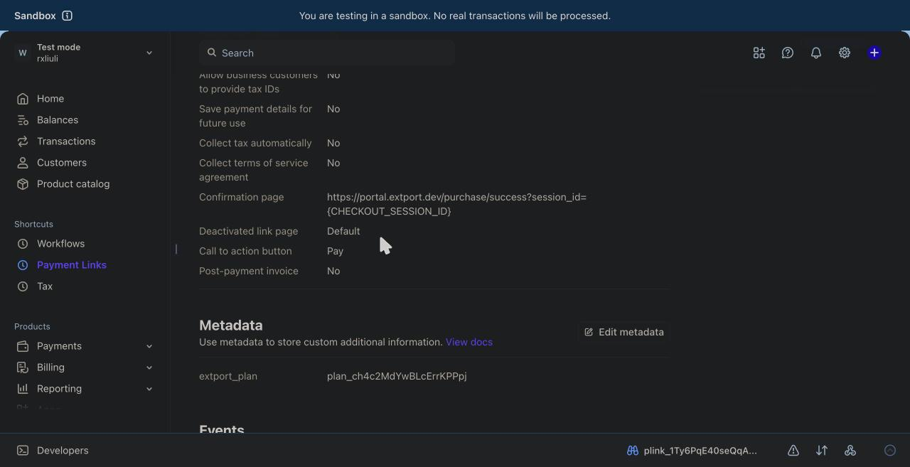
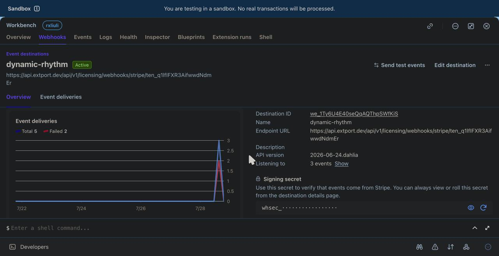

extport supports two cleanly separated monetization models using your own
Stripe account:

- **Licenses (one-time `perpetual` activation codes)** — ideal for
  standalone browser extensions without a backend. Buyers receive an
  activation code (`XXXX-XXXX-XXXX-XXXX`) by email and on the checkout
  success page; the extension verifies codes online via
  [`@extport/sdk`](https://www.npmjs.com/package/@extport/sdk) with device
  seat limits and lazy 30-day seat decay.
- **Subscriptions (account-based `recurring` billing)** — ideal for
  extensions with user accounts and a backend. Stripe fulfills recurring
  checkouts directly into extport's `subscriptions` table (no activation
  codes, no key emails), and your backend calls `/api/v1/subscriptions/*`
  for duplicate-guarded Checkout Sessions, entitlement checks, and one-click
  Stripe Billing Portal sessions.

## 1. Enable licensing and create a plan

On your extension's page in the dashboard, open the **Licensing** tab and
enable licensing (this only turns the public verification endpoints on —
nothing changes for users until your extension ships licensing code).

Then create a plan. A plan is one sellable tier of one extension:

- **Tier** — the level your extension or backend resolves (e.g. `pro`).
  `free` is reserved for the unpaid tier.
- **Billing model** — **One-time** (`perpetual` license) or **Subscription**
  (`recurring` via Stripe). Enter pricing here to sync Stripe Products and
  Prices automatically via your Restricted Key.
- **Max devices** — *(One-time plans only)* how many devices one license
  covers (editable later; applies to codes issued from then on).

Activation codes verify against your **extension's id** (`ext_…`) — the
identity is part of the verification contract baked into shipped builds,
so it's fixed for the life of the extension. The name, in contrast, is
just a label: it never freezes, and renaming it can't break verification.

The plans table shows a `extport_plan=plan_…` value per row — that's the
Stripe metadata you'll need if you also use manual Payment Links.

## 2. Wire up the SDK

```ts
import { createActivationClient } from '@extport/sdk'
import { webextTransport } from '@extport/sdk/webext'

export const client = createActivationClient({
  // extensionId resolves automatically when built with @extport/wxt
  // (extport: { extension: 'ext_…' }); otherwise pass it here:
  // extensionId: 'ext_…',
  plans: {
    free: { records: 100 }, // 'free' is required
    pro: { records: Infinity }, // tier names = your plan tiers
  },
  transport: webextTransport(),
})

// in your UI: activate once, then the plan resolves locally
await client.activate('XXXX-XXXX-XXXX-XXXX')
const plan = await client.getPlan() // { tier: 'pro', limit: … }
```

Call `attachBackground(client)` (from `@extport/sdk/webext`) in your
background entrypoint so activations sync across contexts and re-verify
on browser startup. Verification failures caused by network problems
never revoke anything — only a definitive server answer does.

Before touching Stripe you can already test the full loop: issue a
license by hand from the dashboard's Licensing tab and activate it in a
dev build.

## 3. Choose a Stripe checkout flow

You can sell plans in two ways — **Managed Checkout & Sync (Recommended)** or **Zero-code Payment Links** (for one-time licenses).

### Option A: Managed Stripe control plane (Restricted Key)

Store a **Stripe Restricted Key** (`rk_…`) in [**Settings → Stripe**](https://dash.extport.dev/settings#payment-credentials) with **Write** permission on:

- **Products**
- **Prices**
- **Customers**
- **Checkout Sessions**
- **Customer Portal**

With a Restricted Key configured:

1. **Automatic Product & Price sync**: When creating or editing a plan in the dashboard (or via `POST /api/v1/plans` / `PATCH /api/v1/plans/:id`), enter pricing (`amount` for one-time; `monthlyAmount` / `yearlyAmount` for subscriptions; `currency` defaults to `usd`). extport automatically creates the Stripe Product and Price(s) with `extport_plan` metadata — and when you change a price, creates a new Stripe Price and archives the old one.
2. **Account-based Subscriptions (`/api/v1/subscriptions/*`)**: Your backend calls extport with your tenant API key instead of integrating the Stripe SDK directly:

   ```http
   POST https://api.extport.dev/api/v1/subscriptions/checkout
   Authorization: Bearer <EXTPORT_API_KEY>
   Content-Type: application/json

   {
     "extensionId": "ext_...",
     "tier": "pro",
     "interval": "monthly",
     "externalUserId": "user_123",
     "email": "buyer@example.com",
     "successUrl": "https://example.com/account?upgraded=1",
     "cancelUrl": "https://example.com/pricing"
   }
   ```

   - Returns `{ "action": "checkout", "url": "https://checkout.stripe.com/...", "sessionId": "cs_..." }` for new subscribers (setting `metadata[extport_plan]`, `client_reference_id`, and reusing any existing `cus_…`).
   - If the user already has an active subscription for that extension, blocks duplicate billing and returns `{ "action": "portal", "url": "https://billing.stripe.com/...", "reason": "already_subscribed" }` (or `409` if no Stripe customer ID is on file).
   - Check entitlements server-side with `GET /api/v1/subscriptions/entitlements?extensionId=ext_...&externalUserId=user_123` (or `&email=...`), returning `{ active, tier, subscriptionId, status, currentPeriodStart, currentPeriodEnd, cancelAtPeriodEnd }`.
   - Open a one-click Stripe Billing Portal session with `POST /api/v1/subscriptions/portal` `{ extensionId?, externalUserId?, email?, returnUrl }`.

3. **Managed One-Time License Checkout (`POST /api/v1/licensing/checkout`)**: For `perpetual` plans, call `POST /api/v1/licensing/checkout` with `{ extensionId, tier?, externalUserId?, email?, successUrl, cancelUrl }` to create a Stripe Checkout Session (`mode: 'payment'`) that fulfills into an activation code.

### Option B: Zero-code Payment Links (No API key)

In Stripe (start in **test mode** — the Sandbox banner should be
visible), create a Payment Link for your product's price. None of the
optional checkout fields are needed; extport only uses the buyer's email,
which Stripe always collects.



Two settings on the link matter. **After payment** is part of the creation form itself; **Metadata** isn't — Stripe
only exposes it once the link already exists, from its detail page:

1. **After payment** (set while creating the link, or later via edit → _After payment_ tab): redirect to

   ```
   https://portal.extport.dev/purchase/success?session_id={CHECKOUT_SESSION_ID}
   ```

   so buyers land on a page that shows their activation code the moment
   the payment settles (`{CHECKOUT_SESSION_ID}` stays literal — Stripe
   fills it in). Skipping this works too — the code still arrives by
   email — but the redirect is the smoothest experience.

2. **Metadata** (only after creating the link, from its detail page →
   _Edit metadata_): add one entry, key `extport_plan`, value the
   `plan_…` id from your plans table. This is how a payment finds the
   plan to fulfill — without it, extport ignores the sale.



Enable _Allow promotion codes_ under Advanced options if you use
discount codes.

## 4. Point a webhook at extport

In Workbench → **Webhooks**, add an event destination:

- **URL**: `https://api.extport.dev/api/v1/licensing/webhooks/stripe/<your tenant id>`
  — the exact URL is shown ready-to-copy in [**Settings → Payment
  credentials**](https://dash.extport.dev/settings#payment-credentials).
- **Events**: `checkout.session.completed`, `charge.refunded`,
  `charge.dispute.created` (plus `customer.subscription.created`,
  `customer.subscription.updated`, `customer.subscription.deleted`,
  `invoice.paid`, and `invoice.payment_failed` if you sell
  subscriptions) — the first fulfills purchases, while the subscription
  events keep renewals, trials, and cancellations in sync.
- **Payload style**: Snapshot (the default).



Then copy the destination's **signing secret** (`whsec_…`) into
extport's [**Settings → Payment
credentials**](https://dash.extport.dev/settings#payment-credentials). The secret is write-only —
extport uses it solely to verify that webhook events really come from
Stripe. Test and live mode have separate secrets; store whichever mode
your sales currently run in.

## 5. Buy one

Open your Payment Link and pay with Stripe's test card
`4242 4242 4242 4242` (any future expiry, any CVC). Within seconds:

- the success page shows the activation code,
- the same code lands in the buyer's inbox,
- a license row appears in your Licensing tab (source `stripe`),
- and the code activates inside your extension.

When you're ready to sell for real, repeat steps 3–4 in live mode (a new
Payment Link, a new webhook destination, and its live `whsec_…` replacing
the test one in Settings).

## How the rest behaves

- **Refunds revoke.** A `charge.refunded` or dispute flips the license to
  `refunded`; the buyer's devices lose the entitlement on their next
  online check.
- **Seats decay lazily.** A device idle for 30 days frees its seat
  automatically the moment another device wants one — reinstalls never
  wedge a license permanently. You can also release a seat by hand from
  the license's Devices dialog.
- **Buyers help themselves.** [portal.extport.dev](https://portal.extport.dev/portal)
  lets buyers sign in with their purchase email (magic link, no
  password), see every code and device they own, and jump straight into
  the Stripe Billing Portal via **Manage subscription**.
- **Codes outlive everything.** Issued licenses keep verifying no matter
  what plan you're on — and if verification is ever unreachable,
  activated devices keep working from local state. The failure mode is
  always "no new activations", never "paid features turn off".
