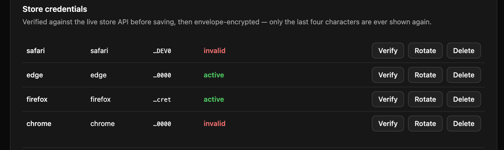
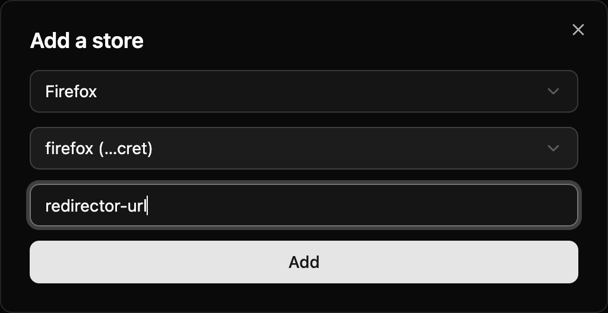
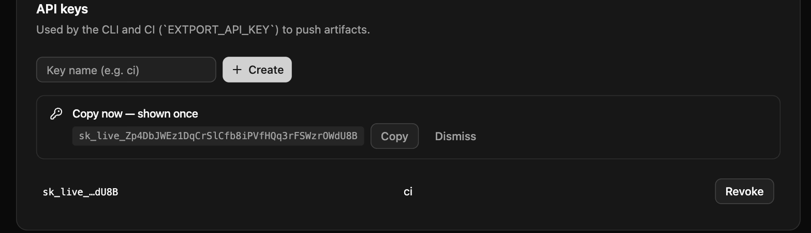

Once you've [signed in and wired up your WXT project](/getting-started/), connect your extension to the stores you
publish to and push a build.

The examples on this page and the store pages all use one real, published extension — [Redirector](https://store.rxliuli.com/extensions/redirector/),
which ships on all four stores — so every id shown is something you can look up yourself, not a placeholder.

:::tip[Start with Firefox for the fastest first push]
If you publish to Firefox (AMO), connect it first: setup takes ~30 seconds (just copy a JWT issuer & secret from AMO
Developer Hub) and AMO gives extport full review-status tracking. If you only ship on Chrome today, jump straight to
the [Chrome](/stores/chrome/) guide.
:::

## 1. Add your store credentials

Under [**Settings → Store credentials**](https://dash.extport.dev/settings#store-credentials), add a credential for each store you publish to. Each row shows the store,
a label, the last four characters of the credential, and whether it verified successfully:



Pick the store you want to connect first — ordered below from quickest setup to most involved:

- [**Firefox**](/stores/firefox/) — **recommended first stop**; 2 fields from AMO Developer Hub, full review tracking.
- [**Chrome**](/stores/chrome/) — Google Cloud service account JSON + Publisher ID, full review tracking.
- [**Edge**](/stores/edge/) — Client ID + API key from Partner Center (keys expire every 72 days; no store status API).
- [**Safari**](/stores/safari/) — App Store Connect Admin API key + macOS signing certificate for CI builds.

When a key changes, use **Rotate…** from the credential's row menu instead of deleting and re-adding it — the
credential keeps its id, so every store target using it keeps working, and you're only asked for the fields that
change.

## 2. Connect a store target

Open your extension and click **Add a store**. This links one of your credentials to the store's own listing id.

Starting with Firefox, Redirector's public AMO listing is
`addons.mozilla.org/firefox/addon/redirector-url/` — its store item id is the `redirector-url` slug (pasting the full
listing URL into the form extracts the slug automatically):



Repeat for Chrome, Edge, and Safari whenever you're ready — every store target under the same extension ships from one
push.

## 3. Get an API key

Under [**Settings → API keys**](https://dash.extport.dev/settings#api-keys), name a key and click **Create**. The full value is shown exactly once — copy it
immediately, since only the last four characters are shown afterward:



This is what GitHub Actions (and headless CI) use to push on your behalf — treat it like a password.

## 4. Push a build

### From your own machine (WXT)

Build your extension with WXT, log in once, and push:

```sh
pnpm zip:firefox    # builds .output/{name}-{version}-firefox.zip and -sources.zip
pnpm zip            # builds .output/{name}-{version}-chrome.zip (also used for Edge)

npx @extport/cli login   # once per machine — stores a key locally (bound to this API origin)
npx @extport/cli push    # WXT project: zips, source zip, version, and extension id all inferred
```

With [`@extport/wxt`](/wxt/) configured, `npx @extport/cli push` infers everything automatically:

- the extension id from `extport.config.json` (kept in sync by `@extport/wxt`),
- each enabled store target's zip from `.output/{name}-{version}-{browser}.zip` (Edge falls back to the Chrome zip when no dedicated Edge zip exists),
- Firefox's required source zip from `.output/{name}-{version}-sources.zip`,
- and the version from each zip's `manifest.json`.

To push a single store while testing:

```sh
npx @extport/cli push --store firefox
```

:::note[Outside a WXT project?]
Pass the zip path as a positional argument and specify `--store` (plus `--source-zip` for minified Firefox builds).
The version still reads from the zip's `manifest.json`, and `--extension` is only needed if you don't have an
`extport.config.json`:

```sh
npx @extport/cli push path/to/my-extension-firefox.zip --store firefox --source-zip path/to/sources.zip
```
:::

### From GitHub Actions

CI can't run the interactive `login`, so pass your `EXTPORT_API_KEY` secret to `extport-dev/actions/push@v1` — everything
else infers from your WXT build output just like the local command. The convention is one step per store (matching what
`extport init` scaffolds), so per-store artifacts like Firefox's source zip attach cleanly and each store fails
independently:

```yaml
- uses: extport-dev/actions/push@v1
  with:
    # file, source zip (.output/{name}-{version}-sources.zip), version, and extension inferred from WXT output
    store: firefox
    api-key: ${{ secrets.EXTPORT_API_KEY }}

- uses: extport-dev/actions/push@v1
  with:
    store: chrome
    api-key: ${{ secrets.EXTPORT_API_KEY }}
```

Edge and Safari follow the same pattern (`store: edge` falls back to the Chrome zip when no dedicated Edge build exists;
`store: safari` registers the version only — no zip travels through extport, see the [Safari](/stores/safari/) page).
`extport init` scaffolds [the complete workflow below](#the-complete-release-workflow) so you never write it by hand.

Every push is validated against its target store before it's accepted: a zip without a `manifest.json`, a manifest
version mismatch, a Chrome-only build (missing `gecko.id` or service-worker-only background) headed for Firefox, or
Manifest V2 headed for Chrome all fail immediately with the reason — not days later in store review.

## The complete release workflow

This is [Redirector's](https://github.com/rxliuli/redirector) actual `release.yaml` — every release of it ships
to all four stores through this exact file, so it is a production-tested reference, not a synthetic sample.
Change the two `env` values and it is yours; `extport init` scaffolds the same file into new WXT projects.

Read it noticing what is **absent**: no AMO JWT, no Chrome service account, no Edge API key. Store submission
happens server-side with the credentials you added in step 1, which never enter CI. The only signing material
in the workflow is Apple's — a structural exception, because the App Store Connect API cannot upload binaries,
so the Safari build must be signed and uploaded from a macOS runner you control.

```yaml
env:
  DIRECTORY: .          # your extension's directory ("." unless a monorepo)
  PROJECT_NAME: redirector

name: Release

# A release is a version bump: push a package.json with a new version to
# main and this fires. No tags to remember, no manual dispatch.
on:
  push:
    branches: [main]
    paths:
      - 'package.json'

jobs:
  version:
    runs-on: ubuntu-latest
    timeout-minutes: 15
    outputs:
      changed: ${{ steps.version.outputs.changed }}
      version: ${{ steps.version.outputs.version }}
    steps:
      - uses: actions/checkout@v5
        with:
          fetch-depth: 2
      - name: Check version change
        id: version
        uses: rxliuli/version-check@v1
        with:
          file: ${{ env.DIRECTORY }}/package.json

  # Firefox, Chrome, and Edge: build with WXT, attach zips to a GitHub Release,
  # push to extport. Submission for review is the reconcile loop's job from
  # here — if a store has a bad day, extport retries on its own schedule and
  # this run stays green.
  release:
    permissions:
      contents: write
    needs: version
    if: needs.version.outputs.changed == 'true'
    runs-on: ubuntu-latest
    timeout-minutes: 15
    steps:
      - uses: actions/checkout@v5
      - uses: pnpm/action-setup@v6
      - uses: actions/setup-node@v6
        with:
          node-version: 24
          cache: 'pnpm'
      - name: Install dependencies
        run: pnpm install
      - name: Zip extensions
        run: |
          cd ${{ env.DIRECTORY }}
          pnpm zip:firefox
          pnpm zip

      - name: Create Release
        uses: softprops/action-gh-release@v3
        with:
          tag_name: 'v${{ needs.version.outputs.version }}'
          name: 'v${{ needs.version.outputs.version }}'
          generate_release_notes: true
          draft: false
          prerelease: false
          files: |
            ${{ env.DIRECTORY }}/.output/${{ env.PROJECT_NAME }}-${{ needs.version.outputs.version }}-firefox.zip
            ${{ env.DIRECTORY }}/.output/${{ env.PROJECT_NAME }}-${{ needs.version.outputs.version }}-sources.zip
            ${{ env.DIRECTORY }}/.output/${{ env.PROJECT_NAME }}-${{ needs.version.outputs.version }}-chrome.zip

      - name: Push to Firefox AMO
        uses: extport-dev/actions/push@v1
        with:
          # file/version inferred from .output/ and its manifest.json; the AMO
          # source zip infers too — .output/{name}-{version}-sources.zip, WXT's
          # own sourcesTemplate (only produced for the firefox build).
          store: firefox
          api-key: ${{ secrets.EXTPORT_API_KEY }}

      - name: Push to Chrome Web Store
        uses: extport-dev/actions/push@v1
        with:
          # file/version/extension inferred from .output/, its manifest.json, and extport.config.json.
          store: chrome
          api-key: ${{ secrets.EXTPORT_API_KEY }}

      - name: Push to Edge Add-ons
        uses: extport-dev/actions/push@v1
        with:
          # Edge is Chromium-based — extport falls back to the chrome zip
          # when no dedicated edge one was built.
          store: edge
          api-key: ${{ secrets.EXTPORT_API_KEY }}

  # Safari: build, sign, and upload the binary from macOS with your own
  # Apple credentials — the one store where CI must hold signing material
  # (the ASC API cannot upload binaries). It never submits for review:
  # extport's reconcile submits on its own once the build finishes
  # processing in App Store Connect, so a red job here just means re-run
  # this job — the queued version waits.
  safari:
    needs: version
    if: needs.version.outputs.changed == 'true'
    runs-on: macos-26
    # macOS runners bill at 10x Linux rates — a hung job burns your whole
    # month of free minutes, so every job here caps its runtime, this one
    # most of all.
    timeout-minutes: 15
    # Apple-side flakiness must not mark the release failed — the other
    # three stores already shipped independently.
    continue-on-error: true
    steps:
      - uses: actions/checkout@v5
      - uses: pnpm/action-setup@v6
      - uses: actions/setup-node@v6
        with:
          node-version: 24
          cache: 'pnpm'
      - name: Install dependencies
        run: pnpm install

      - name: Build Safari extension
        run: pnpm build:safari

      - uses: extport-dev/actions/safari-build@v1
        with:
          # project-path/team-id inferred from extport.config.json (synced by
          # @extport/wxt). Automatic code signing via -allowProvisioningUpdates,
          # reusing the certificate below instead of minting a new one every
          # run — an ephemeral runner has no local keychain, so without this
          # it silently burns one Apple certificate per run until the account
          # hits Apple's cap.
          issuer-id: ${{ secrets.APPLE_API_ISSUER }}
          key-id: ${{ secrets.APPLE_API_KEY_ID }}
          key-base64: ${{ secrets.APPLE_API_KEY }}
          certificate-base64: ${{ secrets.APPLE_CERTIFICATE_BASE64 }}
          certificate-password: ${{ secrets.APPLE_CERTIFICATE_PASSWORD }}
          version: ${{ needs.version.outputs.version }}

      - name: Register the Safari version with extport
        uses: extport-dev/actions/push@v1
        with:
          # version/extension inferred — no zip travels through extport for safari.
          store: safari
          api-key: ${{ secrets.EXTPORT_API_KEY }}
```

### Secrets

| Secret | Used by | Where it comes from |
| --- | --- | --- |
| `EXTPORT_API_KEY` | every push step | [step 3](#3-get-an-api-key) above |
| `APPLE_API_ISSUER`, `APPLE_API_KEY_ID`, `APPLE_API_KEY` | `safari-build` | App Store Connect API key — see [Safari](/stores/safari/) |
| `APPLE_CERTIFICATE_BASE64`, `APPLE_CERTIFICATE_PASSWORD` | `safari-build` | your Apple Distribution certificate, exported as base64 `.p12` — see [Safari](/stores/safari/) |

### Tailoring

- **No Safari target?** Delete the entire `safari` job and the five `APPLE_*` secrets. Nothing else references them.
- **No Chrome or Edge target yet?** Delete those push steps — every store step is completely independent.
- **Monorepo?** Set `DIRECTORY` to the extension's path and add it to the trigger's `paths`.

## Shell completion & CLI version

Check your installed CLI version with `extport -v` / `extport --version`.

`extport completion bash|zsh|fish` prints a Tab-completion script for subcommands, flag names, and the values of
`--store`/`--platform`. It only prints — add the right line to your shell's own config to make it stick, same as
`gh`/`kubectl`/`rustup`:

```sh
# ~/.zshrc
eval "$(extport completion zsh)"

# ~/.bashrc
eval "$(extport completion bash)"

# ~/.config/fish/config.fish
extport completion fish | source
```

Open a new terminal (or `source` the file you just edited) to pick it up. The shell name is optional — omit it
(`extport completion`) and it detects the one you're currently running.
