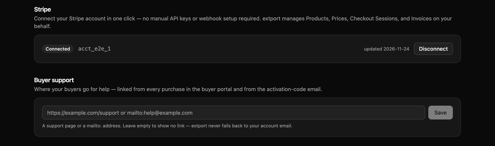
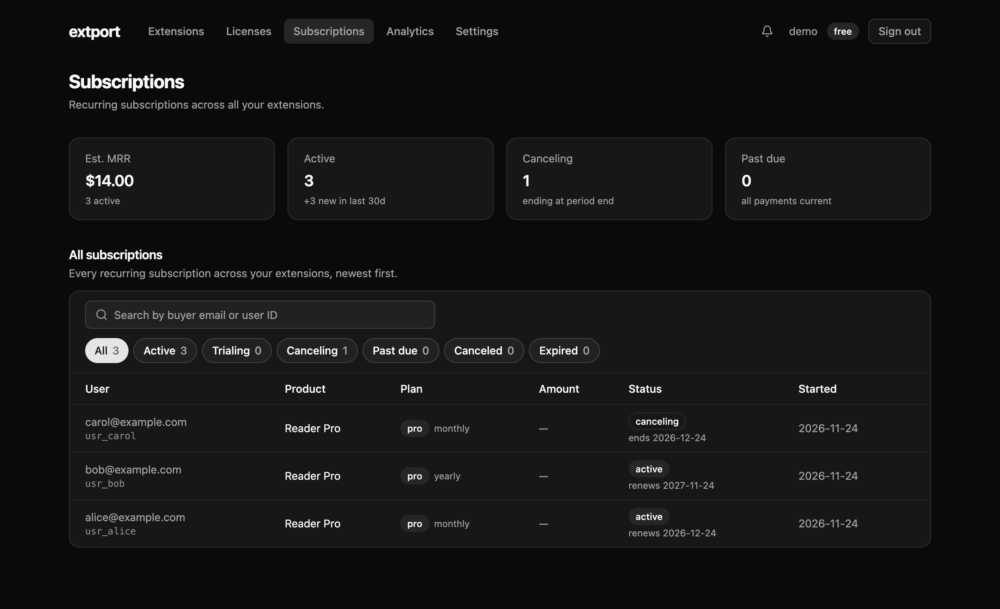
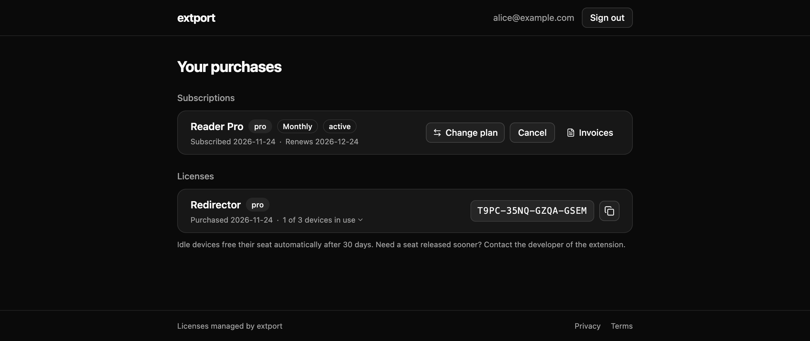

Subscriptions are built for **extensions with user accounts and a backend** (for example, cloud sync, hosted AI quotas,
or team features). Instead of integrating the Stripe SDK, webhooks, and Stripe Billing Portal yourself, your backend
calls extport's `/api/v1/subscriptions/*` API while payments settle directly into your own Stripe account via **Stripe
Connect**.

There are no activation codes or key emails — Stripe recurring checkouts sync directly into extport's `subscriptions`
table, your backend checks entitlements server-side, and subscribers manage cancellations, plan switches, and invoices
inside extport's native Buyer Portal.

:::note[Building a standalone extension without a backend?]
If you just want to sell one-time Pro upgrades without running a server or user login system, use
[Licensing](/licensing/) instead — it requires zero backend code. Each extension chooses one billing mode
(`subscription` or `license`), locked once you create its first plan, subscription, or license.
:::

## 1. Connect your Stripe account

Go to [**Settings → Stripe**](https://dash.extport.dev/settings#payment-credentials) and click **Connect with Stripe**.

This uses Stripe Connect Standard OAuth2:

- You can connect a Stripe Sandbox / Test account first, then switch to Live mode when ready.
- All subscription webhooks (`checkout.session.completed`, `customer.subscription.created`,
  `customer.subscription.updated`, `customer.subscription.deleted`, `invoice.paid`, `invoice.payment_failed`) are
  handled automatically by extport's platform Connect webhook — nothing to configure in Stripe Workbench.
- A connected Stripe account is required before you can enable subscriptions on an extension.



## 2. Enable subscriptions and create plans

Open your extension in the dashboard, switch to the **Licensing** tab, choose **Subscription**, and enable it.

Then create your recurring plans (for example, `pro` monthly and `pro` yearly). Each extension maps to **one Stripe
Product**, and each plan row maps **1:1 to a Stripe Price** synced automatically to your connected Stripe account:

- **Tier** — the entitlement level your backend resolves (e.g. `pro`). `free` is reserved for the unpaid tier.
- **Billing interval & price** — `month` or `year`, with a required `amount` (minimum 50 minor units) and `currency`
  (defaults to USD). Editing a plan's price creates a new Stripe Price and archives the old one automatically.
- **Disable / re-enable** — soft-disable a plan (`active: false`) to stop new signups and plan switches into it without
  interrupting existing subscribers.

## 3. Integrate your backend

Make sure you have a tenant API key from [**Settings → API keys**](https://dash.extport.dev/settings#api-keys)
(`EXTPORT_API_KEY`).

### Start a duplicate-guarded Checkout Session

```http
POST https://api.extport.dev/api/v1/subscriptions/checkout
Authorization: Bearer <EXTPORT_API_KEY>
Content-Type: application/json

{
  "extensionId": "ext_...",
  "planId": "plan_...",
  "externalUserId": "user_123",
  "email": "buyer@example.com"
}
```

- Identify the plan by `planId` **or** by `tier` + `interval` (`"month"` / `"year"`).
- `successUrl` and `cancelUrl` are optional — if omitted, extport defaults to its hosted checkout success page
  (`https://portal.extport.dev/purchase/success?session_id={CHECKOUT_SESSION_ID}`) and the Buyer Portal.
- **New subscriber**: returns `{ "action": "checkout", "url": "https://checkout.stripe.com/...", "sessionId": "cs_..." }`
  and reuses any existing Stripe customer ID on file.
- **Already subscribed**: prevents duplicate billing and returns a single-use Buyer Portal SSO link instead:
  `{ "action": "portal", "url": "https://portal.extport.dev/portal?code=...", "reason": "already_subscribed" }`.

Redirect the user straight to `url` regardless of whether `action` is `"checkout"` or `"portal"`.

### Check entitlements server-side

```http
GET https://api.extport.dev/api/v1/subscriptions/entitlements?extensionId=ext_...&externalUserId=user_123
Authorization: Bearer <EXTPORT_API_KEY>
```

Accepts `externalUserId` or `email`, and returns:

```json
{
  "active": true,
  "tier": "pro",
  "subscriptionId": "sub_...",
  "status": "active",
  "currentPeriodStart": "2026-11-24T00:00:00.000Z",
  "currentPeriodEnd": "2026-12-24T00:00:00.000Z",
  "cancelAtPeriodEnd": false
}
```

### Open Buyer Portal via one-click SSO

Instead of making signed-in users request an email magic link, mint a single-use SSO URL from your backend:

```http
POST https://api.extport.dev/api/v1/subscriptions/portal
Authorization: Bearer <EXTPORT_API_KEY>
Content-Type: application/json

{
  "externalUserId": "user_123"
}
```

Returns `{ "url": "https://portal.extport.dev/portal?code=..." }` (single-use, valid for 15 minutes; accepts
`externalUserId` or `email`, plus optional `extensionId` and `returnUrl`).

:::note[Static pricing page without a backend checkout endpoint?]
Every active subscription plan also works with the public hosted checkout URL
`https://portal.extport.dev/api/v1/portal/buy/<plan_id>` (with optional `?success_url=…&cancel_url=…`). Note that
public links cannot attach your own `externalUserId` — your backend will match subscribers by `email` instead.
:::

## 4. Track MRR and subscribers

Open the global [**Subscriptions**](https://dash.extport.dev/subscriptions) page for **Est. MRR** (yearly plans
normalized to monthly), **Active**, **Canceling**, and **Past due** KPIs, status filters, and email/user ID search across
all extensions — or inspect a single extension's **Licensing** tab.



## 5. Native Buyer Portal

Subscribers manage their billing at [portal.extport.dev/portal](https://portal.extport.dev/portal) via passwordless
email magic link or one-click SSO from `POST /api/v1/subscriptions/portal` — **no Stripe Billing Portal configuration
required**:

- **Cancel & resume**: schedule cancellation at the end of the current billing period, or resume before it expires.
- **Change plan at period end**: switch between active plans on the same extension and currency (for example, monthly ↔
  yearly or tier upgrades/downgrades) via Stripe Subscription Schedules, with the ability to cancel a scheduled change.
- **Native invoices**: view up to 24 recent Stripe invoices with direct links to Stripe's hosted invoice page and PDF
  receipts.
- Configure an optional help URL in [**Settings → Buyer support**](https://dash.extport.dev/settings#buyer-support) to
  surface your support link on every subscription card.



## How the rest behaves

- **Automatic lifecycle sync.** Renewals, trials (`trialing`), payment failures (`past_due`), scheduled cancellations
  (`cancelAtPeriodEnd`), and expirations stay in sync automatically from Stripe Connect webhooks.
- **Duplicate billing is blocked.** Calling `POST /api/v1/subscriptions/checkout` for an already-entitled user never
  starts a second Stripe subscription — it routes them straight into the Buyer Portal via SSO.
- **Disabling a plan is safe.** Soft-disabling a plan stops new checkouts and plan switches into it while existing
  subscribers continue renewing normally.
